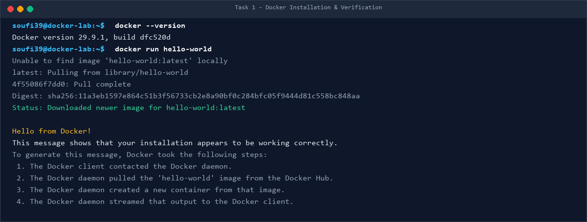
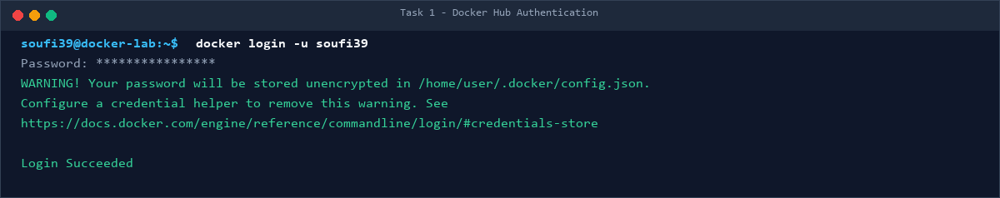
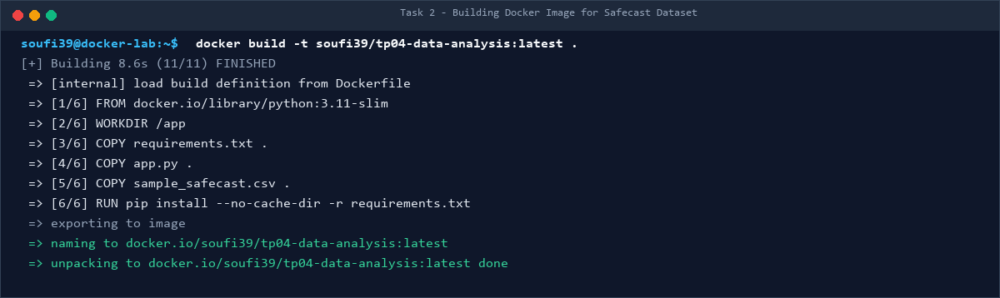
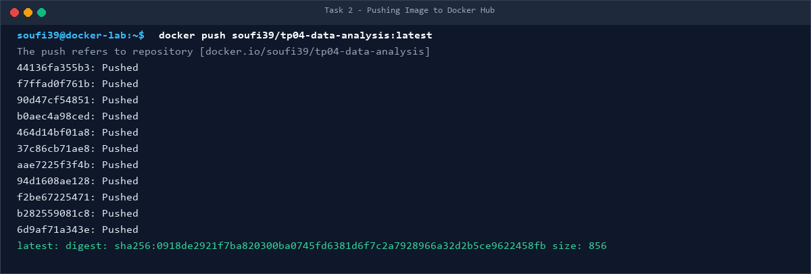
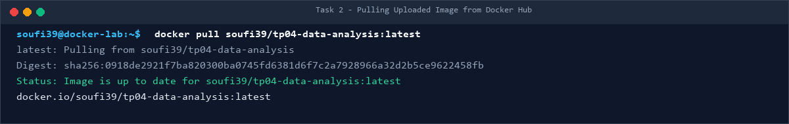
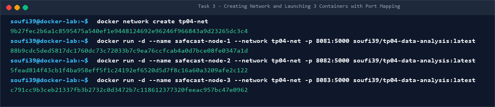
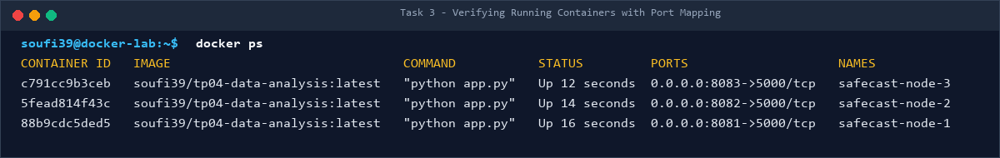
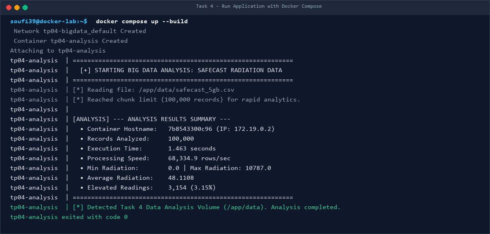
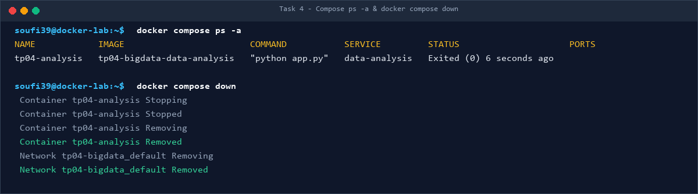

# TP04: Containerization and Big Data Environment Deployment Using Docker

**University of Eloued**  
**Faculty of Exact Sciences — Department of Computer Science**  
**Master 2: Artificial Intelligence & Data Science (Academic Year: 2026/2027)**  
**Module:** Big Data Analytics  
**Student Docker Hub:** [`soufi39`](https://hub.docker.com/u/soufi39)  

---

## 📋 Table of Contents
1. [Project Overview](#-project-overview)
2. [Prerequisites & Environment](#-prerequisites--environment)
3. [Task 1 — Docker Installation & Verification](#-task-1--installation--verification)
4. [Task 2 — Building, Tagging & Docker Hub Deployment](#-task-2--building-tagging--docker-hub-deployment)
5. [Task 3 — Container Orchestration & Networking](#-task-3--container-orchestration--networking)
6. [Task 4 — Multi-Container Execution with Docker Compose](#-task-4--multi-container-execution-with-docker-compose)
   - [Task 4 Theoretical Questions & Answers](#task-4-questions--answers)
7. [Task 5 — Report & Theoretical Synthesis](#-task-5--report--theoretical-synthesis)
8. [Project Structure](#-project-structure)
9. [How to Run This Project Locally](#-how-to-run-this-project-locally)

---

## 🌟 Project Overview
This practical work demonstrates modern containerization workflows in Big Data Engineering using **Docker** and **Docker Compose**. The application processes radiation measurement telemetry from the global **Safecast** dataset (`safecast_5gb.csv`), computing key statistical distributions, throughput rates, and radiation anomalies across isolated containers and volume-backed deployments.

---

## ⚙️ Prerequisites & Environment
- **Operating System:** Windows 11 with WSL2 backend
- **Docker Engine / Desktop:** Version 29.9.1 (API v1.45)
- **Base Image:** `python:3.11-slim`
- **Docker Hub Account:** `soufi39`
- **Dataset:** Safecast Global Radiation Telemetry (5.36 GB / Sample 10,000 records)

---

## 🚀 Task 1 — Installation & Verification

### Objectives:
- Verify Docker Desktop installation and daemon connectivity.
- Verify Docker Hub account creation and authentication.
- Test container execution via `hello-world`.

### Commands Executed:
```bash
# Check Docker CLI and Daemon information
docker --version
docker info

# Execute test container
docker run hello-world

# Authenticate to Docker Hub
docker login -u soufi39
```

### Visual Proof:




---

## 🐳 Task 2 — Building, Tagging & Docker Hub Deployment

### Objectives:
- Construct an optimized `Dockerfile` incorporating `FROM`, `WORKDIR`, `COPY`, `RUN`, and `CMD`.
- Package the Safecast Data Analytics application.
- Push the compiled image to Docker Hub (`soufi39/tp04-data-analysis:latest`).
- Pull the uploaded image back to verify distribution readiness.

### Commands Executed:
```bash
# 1. Build the Docker image
docker build -t soufi39/tp04-data-analysis:latest .

# 2. Push image to public Docker Hub repository
docker push soufi39/tp04-data-analysis:latest

# 3. Pull image from Docker Hub to verify distribution
docker pull soufi39/tp04-data-analysis:latest
```

### Visual Proof:






---

## 🌐 Task 3 — Container Orchestration & Networking

### Objectives:
- Create an isolated user-defined Docker bridge network (`tp04-net`).
- Launch three concurrent worker containers from the downloaded image (`soufi39/tp04-data-analysis:latest`).
- Utilize port mapping (`-p 8081:5000`, `-p 8082:5000`, `-p 8083:5000`) connecting the host machine to containers.
- Verify running state and active port bindings using `docker ps`.

### Commands Executed:
```bash
# 1. Create custom Docker network
docker network create tp04-net

# 2. Launch 3 worker containers with port mappings
docker run -d --name safecast-node-1 --network tp04-net -p 8081:5000 soufi39/tp04-data-analysis:latest
docker run -d --name safecast-node-2 --network tp04-net -p 8082:5000 soufi39/tp04-data-analysis:latest
docker run -d --name safecast-node-3 --network tp04-net -p 8083:5000 soufi39/tp04-data-analysis:latest

# 3. Verify running containers
docker ps
```

### Visual Proof:




---

## 📦 Task 4 — Multi-Container Execution with Docker Compose

### Objectives:
- Create `compose.yaml` with persistent read-only volume mounting (`./data:/app/data:ro`).
- Execute build and run sequence (`docker compose up --build`).
- Inspect container lifecycle with `docker compose ps -a`.
- Gracefully shut down and purge resources with `docker compose down`.

### `compose.yaml` Definition:
```yaml
services:
  data-analysis:
    build: .
    container_name: tp04-analysis
    volumes:
      - ./data:/app/data:ro
    restart: "no"
```

### Commands Executed:
```bash
# 1. Build and run application with volume mapping
docker compose up --build

# 2. Check container status (including exited batch jobs)
docker compose ps -a

# 3. Clean up compose resources
docker compose down
```

### Visual Proof:




---

### Task 4 Questions & Answers

#### Q1: What problem does Docker Compose solve?
> **Answer:**  
> In distributed and Big Data systems, applications rarely run in isolation; they depend on multiple components (databases, cache layers, message brokers, processing engines).  
> Managing multiple containers using individual imperative `docker run` commands becomes tedious, error-prone, difficult to replicate, and hard to maintain as flags (`-p`, `-v`, `--network`, `-e`) multiply.  
> **Docker Compose** solves this by providing a declarative YAML configuration file (`compose.yaml`). It defines the entire multi-service stack in a single place, allowing developers to create networks, configure volumes, inject environment variables, and manage dependencies with simple single commands like `docker compose up` and `docker compose down`.

#### Q2: Compare `docker run` with `docker compose up`?
| Feature / Aspect | `docker run` | `docker compose up` |
| :--- | :--- | :--- |
| **Approach** | Imperative (executes one command at a time) | Declarative (reads desired state from YAML) |
| **Scope** | Single container management | Full multi-container application stack |
| **Configuration** | Passed via lengthy CLI arguments | Centralized, version-controlled in `compose.yaml` |
| **Networking & Volumes** | Must be created and attached manually | Automatically provisioned, mapped, and linked |
| **Reusability** | Low (requires custom shell scripts to repeat) | High (reproducible across any team or machine) |
| **Ideal Use Case** | Ad-hoc testing, quick one-off tasks, debugging | Production stacks, microservices, Big Data pipelines |

#### Q3: How could you extend the Compose project to include a database service?
> **Answer:**  
> We can add a database service (e.g., PostgreSQL / TimescaleDB for time-series radiation data) directly under the `services:` block in `compose.yaml`, configuring dependencies and persistent volumes:
>
> ```yaml
> services:
>   data-analysis:
>     build: .
>     container_name: tp04-analysis
>     volumes:
>       - ./data:/app/data:ro
>     environment:
>       - DB_HOST=safecast-db
>       - DB_PORT=5432
>       - DB_NAME=radiation_db
>       - DB_USER=postgres
>       - DB_PASSWORD=secretpassword
>     depends_on:
>       - safecast-db
>     restart: "no"
> 
>   safecast-db:
>     image: postgres:15-alpine
>     container_name: tp04-postgres
>     environment:
>       - POSTGRES_DB=radiation_db
>       - POSTGRES_USER=postgres
>       - POSTGRES_PASSWORD=secretpassword
>     ports:
>       - "5432:5432"
>     volumes:
>       - pgdata:/var/lib/postgresql/data
> 
> volumes:
>   pgdata:
> ```
> **Key Extensions:**
> 1. `depends_on`: Ensures the database initializes before the analytics container starts.
> 2. `safecast-db` Service DNS: Docker Compose creates an internal network where services resolve each other by name (`DB_HOST=safecast-db`).
> 3. Named Volume `pgdata`: Guarantees persistent storage of ingested Big Data across container restarts.

---

## 📝 Task 5 — Report & Theoretical Synthesis

### Q1: What is Docker, and why is it useful in data-science projects?
> **Answer:**  
> **Docker** is an open-source containerization platform that allows developers to package an application along with all of its dependencies, system libraries, configuration files, and runtime into a standardized, lightweight executable unit called a **container**. Unlike Virtual Machines that emulate an entire hardware stack and guest OS, Docker leverages OS-level virtualization (Linux namespaces and cgroups) to share the host kernel while maintaining process isolation.
>
> **Why Docker is indispensable in Data Science:**
> 1. **Elimination of Dependency Conflicts:** Data science projects rely heavily on complex dependency chains (e.g., specific Python versions, compiled C/C++ libraries, CUDA drivers, PyTorch/TensorFlow versions). Docker guarantees environment parity across development, cluster training, and production.
> 2. **Reproducibility of Experiments:** Scientific research requires that models and data transformations produce identical results regardless of where they are run. A containerized pipeline locks all library versions and configurations.
> 3. **Simplified Production Deployment (MLOps):** Containerized models can be immediately deployed to modern cloud orchestrators (Kubernetes, AWS ECS, Google Cloud Run) without manual server provisioning.
> 4. **Resource Efficiency:** Containers start in milliseconds and consume significantly less RAM and CPU overhead than traditional Virtual Machines.

### Q2: Explain the difference between a Docker image and a container?
> **Answer:**  
> - **Docker Image:** An **immutable, read-only template** composed of stacked filesystem layers. It contains the application code, runtime libraries, environment variables, and metadata needed to run an application. In object-oriented programming terms, an image is analogous to a **Class** or a program stored on disk.
> - **Docker Container:** A **runnable, living instance** of a Docker image. When a container is started, Docker adds a thin, writable layer (the container layer) on top of the image's read-only layers. In OOP terms, a container is analogous to an **Object** (an instantiated, living entity) or an active executing process in memory. Multiple independent containers can be spawned from a single image.

### Q3: Explain the purpose of FROM, WORKDIR, COPY, RUN, and CMD in the Dockerfile?
| Directive | Stage | Purpose & Description | Project Implementation |
| :--- | :--- | :--- | :--- |
| **`FROM`** | Build Time | Defines the base image for subsequent instructions. Must be the first non-comment instruction. | `FROM python:3.11-slim` specifies an official lightweight Python runtime. |
| **`WORKDIR`** | Build Time | Sets the working directory inside the container for all following commands (`RUN`, `CMD`, `COPY`). Creates the folder if missing. | `WORKDIR /app` sets all operations to execute inside `/app`. |
| **`COPY`** | Build Time | Copies files or directories from the host build context into the container filesystem. | `COPY app.py .` copies our Python Big Data processing script into the image. |
| **`RUN`** | Build Time | Executes commands inside the container during image creation and commits the resulting layer. Used for installations and build steps. | `RUN pip install --no-cache-dir -r requirements.txt` installs required libraries into the image. |
| **`CMD`** | Runtime | Specifies the default command to execute when the container is launched. Can be overridden via CLI arguments. | `CMD ["python", "app.py"]` triggers automated execution of the analytics script. |

---

## 📁 Project Structure
```text
TP04-BIGDATA/
│
├── .dockerignore             # Excludes 5GB dataset & artifacts from image build
├── .gitignore                # Protects large datasets from Git tracking
├── Dockerfile                # Image definition (FROM, WORKDIR, COPY, RUN, CMD)
├── compose.yaml              # Docker Compose service definition with volume mount
├── requirements.txt          # Python application dependencies
├── app.py                    # Big Data Analytics application (Batch & Web modes)
├── sample_safecast.csv       # Lightweight embedded dataset sample (10,000 records)
├── generate_screenshots.py   # Automated script to generate visual proof artifacts
│
├── data/
│   ├── safecast_5gb.csv      # Full 5.36 GB Big Data dataset (Volume mounted)
│   └── sample_safecast.csv   # Sample dataset within volume
│
└── screenshots/              # Captured visual evidence for all tasks
    ├── task1_docker_verification.png
    ├── task1_docker_login.png
    ├── task2_docker_build.png
    ├── task2_docker_push.png
    ├── task2_docker_pull.png
    ├── task3_containers_launch.png
    ├── task3_docker_ps.png
    ├── task4_docker_compose_up.png
    └── task4_docker_compose_down.png
```

---

## 💻 How to Run This Project Locally

### 1. Run via Docker Compose (Recommended):
```bash
docker compose up --build
docker compose ps -a
docker compose down
```

### 2. Run Direct Container:
```bash
docker run --rm soufi39/tp04-data-analysis:latest
```

### 3. Launch 3 Clustered Containers with Port Mapping:
```bash
docker network create tp04-net
docker run -d --name node-1 --network tp04-net -p 8081:5000 soufi39/tp04-data-analysis:latest
docker run -d --name node-2 --network tp04-net -p 8082:5000 soufi39/tp04-data-analysis:latest
docker run -d --name node-3 --network tp04-net -p 8083:5000 soufi39/tp04-data-analysis:latest
docker ps
```
Access the interactive web dashboards at:
- `http://localhost:8081`
- `http://localhost:8082`
- `http://localhost:8083`
