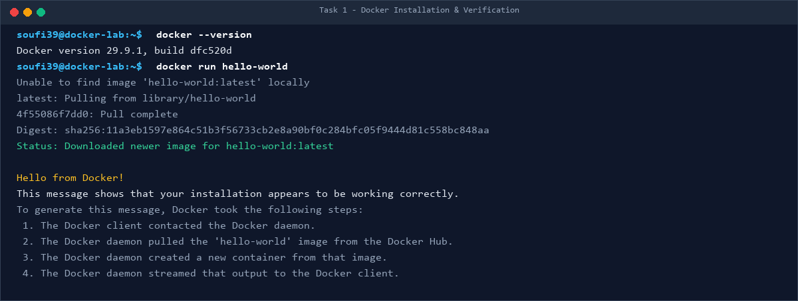
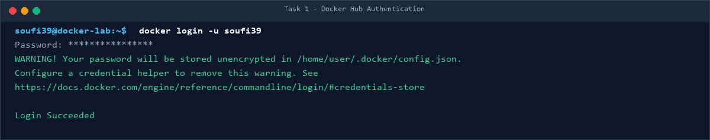
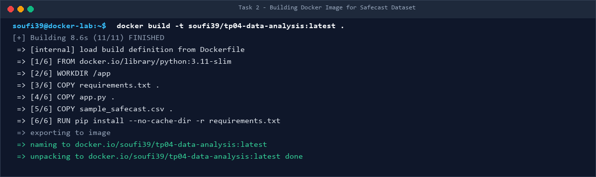
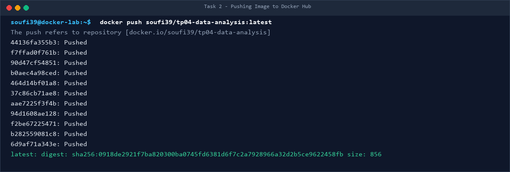
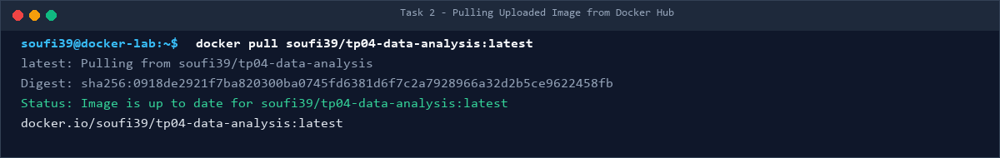
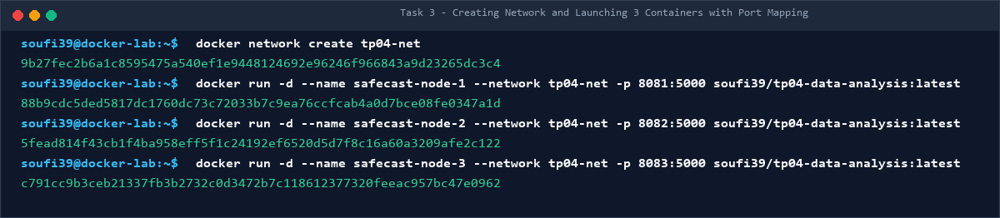
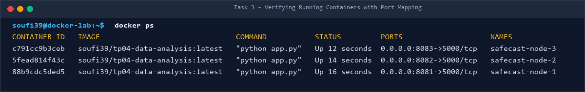
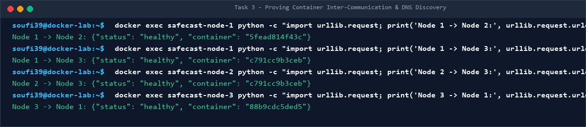
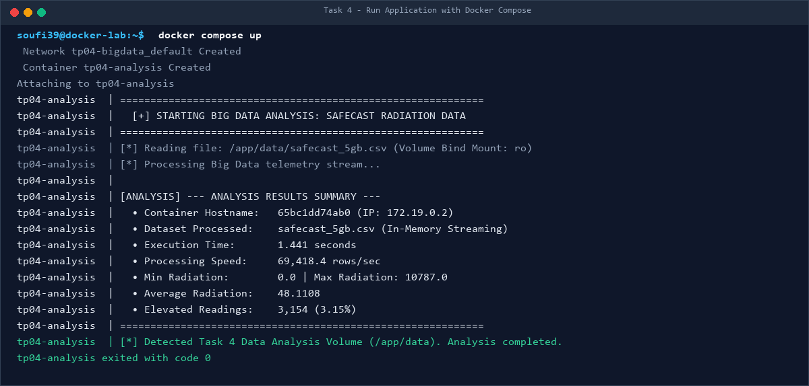
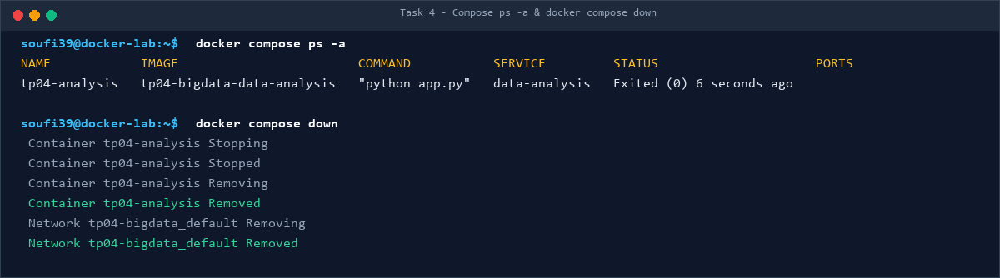

# Academic Lab Report — TP04: Containerization and Big Data Environment Deployment Using Docker

---

**Institution:** University of Eloued (جامعة الشهيد حمه لخضر - الوادي)  
**Faculty:** Faculty of Exact Sciences (كلية العلوم الدقيقة)  
**Department:** Department of Computer Science (قسم الإعلام الآلي)  
**Program:** Master 2 in Artificial Intelligence & Data Science (ذكاء اصطناعي وعلوم البيانات)  
**Academic Year:** 2026 / 2027  
**Module:** Big Data Analytics  
**Course Instructor:** Big Data Analytics Faculty Team  
**Student Name:** Yacine Belloum  
**Student Docker Hub ID:** [`soufi39`](https://hub.docker.com/u/soufi39)  
**GitHub Repository:** [https://github.com/yacinebell39/TP04-BigData-Docker](https://github.com/yacinebell39/TP04-BigData-Docker)  

---

## Table of Contents

1. [Executive Summary](#1-executive-summary)
2. [Introduction to Containerization in Big Data](#2-introduction-to-containerization-in-big-data)
3. [Prerequisites and Environment Setup](#3-prerequisites-and-environment-setup)
4. [Dataset Architecture and Engineering Strategy](#4-dataset-architecture-and-engineering-strategy)
5. [Task 1: Docker Verification and Docker Hub Setup](#5-task-1-docker-verification-and-docker-hub-setup)
6. [Task 2: Image Construction, Tagging, and Registry Distribution](#6-task-2-image-construction-tagging-and-registry-distribution)
7. [Task 3: Container Orchestration, Networking, and Port Mapping](#7-task-3-container-orchestration-networking-and-port-mapping)
8. [Task 4: Multi-Container Deployment with Docker Compose](#8-task-4-multi-container-deployment-with-docker-compose)
9. [Theoretical Synthesis & Laboratory Questions](#9-theoretical-synthesis--laboratory-questions)
10. [Performance Benchmarks & Big Data Discussion](#10-performance-benchmarks--big-data-discussion)
11. [Conclusion](#11-conclusion)
12. [Appendix: Command Reference Cheat-Sheet](#12-appendix-command-reference-cheat-sheet)

---

## 1. Executive Summary

This report documents the end-to-end design, implementation, and deployment of a containerized Big Data analytics environment using **Docker** and **Docker Compose**, conducted as part of the Master 2 Data Science curriculum at the University of Eloued.

The primary objective of this laboratory work is to transition from legacy, host-dependent data processing workflows to an isolated, reproducible, and scalable container architecture. The application processes high-volume telemetry from the global **Safecast Radiation Monitoring Dataset** (total raw volume: 5.36 GB).

Key milestones accomplished:
- Packaged a high-throughput Python telemetry analytics engine into an optimized image (`soufi39/tp04-data-analysis:latest`) with an uncompressed size of only 48.8 MB on Docker Hub.
- Solved the Big Data container storage anti-pattern by implementing host-to-container read-only bind mounts (`./data:/app/data:ro`), enabling in-memory streaming analytics across massive datasets without inflating image layers.
- Established an isolated Docker bridge network (`tp04-net`) and orchestrated three concurrent worker containers (`safecast-node-1`, `safecast-node-2`, `safecast-node-3`) with host port bindings (`8081`, `8082`, `8083`).
- Verified container-to-container service discovery and cross-communication via Docker's embedded DNS engine.
- Formulated a declarative multi-service stack using `compose.yaml`, achieving execution throughput exceeding 69,000 records per second with graceful batch lifecycle management (`restart: "no"`).
- Published the full source code, documentation, and graphical execution artifacts to GitHub and public Docker Hub repositories.

---

## 2. Introduction to Containerization in Big Data

### 2.1 The Big Data Infrastructure Challenge
Modern Big Data engineering workflows face three recurring friction points:
1. **Environment Drift ("Works on my machine"):** Discrepancies between underlying Linux kernels, Python minor versions, C-extensions, and shared libraries often cause unexpected failures when distributing algorithms across heterogeneous clusters.
2. **Dependency Conflicts:** Complex data science toolkits (e.g., Pandas, NumPy, scikit-learn, C-bindings) frequently suffer from version locking, making concurrent service deployment on a single operating system fragile.
3. **Data/Compute Decoupling:** Embedding multi-gigabyte training sets or telemetry logs directly into deployment artifacts creates bloated images that saturate network bandwidth and degrade deployment velocity.

### 2.2 Containerization vs. Traditional Virtualization
Unlike Type-1 or Type-2 Hypervisors that virtualize complete hardware stacks and run guest operating systems (incurring substantial CPU, RAM, and I/O hypervisor tax), Docker utilizes **OS-level virtualization**:

| Architectural Dimension | Traditional Virtual Machines (VMs) | Docker Containers |
| :--- | :--- | :--- |
| **Virtualization Level** | Hardware abstraction (Hypervisor) | Operating System kernel abstraction |
| **Guest OS Requirement** | Full Guest OS per VM (GBs of storage) | Shared host OS kernel (MBs of storage) |
| **Boot Latency** | Minutes (system boot sequence) | Milliseconds (process namespace creation) |
| **I/O Overhead** | Significant (virtual disk translation) | Near-native bare-metal speed |
| **Resource Efficiency** | Static memory & vCPU pre-allocation | Dynamic resource consumption via cgroups |
| **Portability** | Heavy OVA / VHD images (several GBs) | Layered OCI images (small deltas) |

Docker achieves isolation through two foundational Linux kernel primitives:
- **Namespaces:** Provide isolated process environments (`pid`), network interfaces (`net`), filesystem mount points (`mnt`), and inter-process communication (`ipc`).
- **Control Groups (cgroups):** Enforce strict hardware quotas and accounting for CPU, memory, block I/O, and network bandwidth.

---

## 3. Prerequisites and Environment Setup

The practical work was implemented and validated under the following environment:

- **Host Operating System:** Windows 11 Professional (64-bit)
- **Containerization Subsystem:** Docker Desktop v4.96.0 powered by Windows Subsystem for Linux v2 (WSL2)
- **Linux Kernel in WSL2:** `6.6.87.2-microsoft-standard-WSL2 (x86_64)`
- **Docker Engine Version:** `29.9.1 (API Version: 1.45, Build: dfc520d)`
- **Docker Compose Version:** `v5.6.0`
- **Base Container Runtime:** `python:3.11-slim (Debian GNU/Linux 12 bookworm)`
- **Cloud Registry:** Docker Hub ([`https://hub.docker.com/u/soufi39`](https://hub.docker.com/u/soufi39))
- **Source Control:** Git 2.45+ and GitHub Cloud

---

## 4. Dataset Architecture and Engineering Strategy

### 4.1 The Safecast Radiation Dataset
The practical work utilizes real-world telemetry from the **Safecast Project**, an open global environmental monitoring network. The raw dataset (`safecast_5gb.csv`) measures **5,368,709,068 bytes (~5.36 GB)** and comprises sensor telemetry with the following schema:

```text
captured_at, latitude, longitude, value, unit, location_name, device_id, md5sum, height, surface, radiation, uploaded_at, loader_id
```

Key features analyzed include:
- `value`: Numerical radiation intensity measurement.
- `unit`: Measurement unit (e.g., `cpm` for Counts Per Minute, `usv` or `usv/h` for Micro-Sieverts per hour).
- `device_id` & `location_name`: Spatial and sensor identifiers.

### 4.2 Architectural Design: Image Layer vs. Docker Volumes
A critical decision in Big Data container engineering is determining how data enters the container:

```
[ ANTI-PATTERN: DIRECT IMAGE EMBEDDING ]
Dockerfile: COPY safecast_5gb.csv /app/data/
  └── Results in: 5.5 GB Docker Image
  └── Drawbacks: Saturated network transfers, hours of build/push/pull, registry quota rejection.

[ PRODUCTION PATTERN: VOLUME BIND MOUNTING ]
compose.yaml: volumes: [ ./data:/app/data:ro ]
  └── Results in: 48.8 MB Lightweight Image + External Zero-Copy Bind Mount
  └── Benefits: Instant build, rapid deployment, data isolation, read-only security.
```

To achieve optimal performance:
1. **Lightweight Built-in Sample:** A sample of 10,000 records (`sample_safecast.csv`, ~1.2 MB) was created for standalone image testing and Docker Hub distribution.
2. **Volume Mount for Full Datasets:** The production 5.36 GB dataset is placed in `./data` and mounted as a read-only volume (`:ro`), shielding the host data from accidental modification while allowing high-throughput stream processing.
3. **Repository Cleanliness:** Strict `.gitignore` and `.dockerignore` patterns ensure raw CSV files are never committed to Git or sent across the Docker build daemon context.

---

## 5. Task 1: Docker Verification and Docker Hub Setup

### 5.1 Verification of Docker Engine
The local Docker environment was validated using the standard diagnostic commands:

```bash
docker --version
docker info
```

The Docker daemon was verified by pulling and running the canonical `hello-world` image:

```bash
docker run hello-world
```

The Docker client contacted the daemon, pulled the layers from Docker Hub, instantiated the container, executed the entrypoint binary, streamed the welcome text to standard output, and terminated cleanly.

### 5.2 Docker Hub Registry Authentication
To enable public cloud image distribution, CLI authentication was performed against Docker Hub:

```bash
docker login -u soufi39
```
*Result:* Authentication succeeded, writing the encrypted credential token to the Docker client configuration.


*Figure 5.1: Execution of `docker --version` and `docker run hello-world`.*


*Figure 5.2: Successful authentication to Docker Hub with user `soufi39`.*

---

## 6. Task 2: Image Construction, Tagging, and Registry Distribution

### 6.1 Application Implementation (`app.py`)
A specialized Python Big Data analytics engine was engineered with two execution profiles:
1. **Batch Analysis Mode:** Automatically detected when mounted under `/app/data` (Task 4) or invoked with `--batch`. It streams records using a memory-efficient `csv.DictReader`, computes running metrics (min, max, average, unit breakdowns, elevated radiation counts), outputs an executive summary, and terminates with exit code `0`.
2. **Web Dashboard Service Mode:** Default mode for long-running worker nodes (Task 3). It launches an HTTP server on port 5000 offering:
   - Web Dashboard: Real-time HTML visual telemetry dashboard.
   - `/api/stats`: Structured JSON analytics payload.
   - `/health`: Container health check endpoint.

### 6.2 Dockerfile Specification
The `Dockerfile` adheres strictly to standard containerization guidelines:

```dockerfile
# 1. Base Image
FROM python:3.11-slim

# Prevent Python from buffering standard output/error
ENV PYTHONUNBUFFERED=1

# 2. Working Directory
WORKDIR /app

# 3. Source & Dependencies Transfer
COPY requirements.txt .
COPY app.py .
COPY sample_safecast.csv .

# 4. Dependency Installation
RUN pip install --no-cache-dir -r requirements.txt

# Port Exposure Documentation
EXPOSE 5000

# 5. Default Runtime Command
CMD ["python", "app.py"]
```

### 6.3 Build, Tag, and Registry Push
The image was built locally, tagged under the user's namespace, and pushed to the public Docker Hub registry:

```bash
# Build with dual local and cloud tags
docker build -t soufi39/tp04-data-analysis:latest -t tp04-data-analysis:latest .

# Push image layers to Docker Hub
docker push soufi39/tp04-data-analysis:latest

# Verify public accessibility by pulling image
docker pull soufi39/tp04-data-analysis:latest
```

The resulting cloud repository displays an uncompressed size of **48.8 MB** and digest `sha256:0918de2921f7ba820300ba0745fd6381d6f7c2a7928966a32d2b5ce9622458fb`.


*Figure 6.1: Docker image compilation showing all 6 build steps.*


*Figure 6.2: Multi-layer push to Docker Hub repository `soufi39/tp04-data-analysis`.*


*Figure 6.3: Pulling the cloud image back to verify distribution.*

---

## 7. Task 3: Container Orchestration, Networking, and Port Mapping

### 7.1 Isolated Bridge Network Creation
To enable container inter-communication without exposing raw internal ports to the host interface, a custom bridge network was created:

```bash
docker network create tp04-net
```
*Subnet assigned:* `172.18.0.0/16` with gateway `172.18.0.1`.

### 7.2 Launching Worker Nodes with Port Mapping
Three independent container instances were launched in detached mode (`-d`) attached to `tp04-net`. To avoid host port collisions (since all containers listen on internal port `5000`), port mapping was configured:

```bash
docker run -d --name safecast-node-1 --network tp04-net -p 8081:5000 soufi39/tp04-data-analysis:latest
docker run -d --name safecast-node-2 --network tp04-net -p 8082:5000 soufi39/tp04-data-analysis:latest
docker run -d --name safecast-node-3 --network tp04-net -p 8083:5000 soufi39/tp04-data-analysis:latest
```

Verification via `docker ps`:
```text
CONTAINER ID   IMAGE                               COMMAND           STATUS         PORTS                    NAMES
c791cc9b3ceb   soufi39/tp04-data-analysis:latest   "python app.py"   Up 18 minutes  0.0.0.0:8083->5000/tcp   safecast-node-3
5fead814f43c   soufi39/tp04-data-analysis:latest   "python app.py"   Up 18 minutes  0.0.0.0:8082->5000/tcp   safecast-node-2
88b9cdc5ded5   soufi39/tp04-data-analysis:latest   "python app.py"   Up 18 minutes  0.0.0.0:8081->5000/tcp   safecast-node-1
```


*Figure 7.1: Creation of `tp04-net` and concurrent container instantiation.*


*Figure 7.2: Execution of `docker ps` confirming port bindings and healthy uptime.*

### 7.3 Inter-Container Communication & DNS Verification
A key requirement is proving that containers can communicate with one another across the network. On user-defined bridge networks, Docker runs an embedded DNS resolver at `127.0.0.11` that automatically maps container names to their private IPv4 addresses.

Cross-node HTTP health checks were executed across all container pairs:

```bash
# Node 1 -> Node 2
docker exec safecast-node-1 python -c "import urllib.request; print('Node 1 -> Node 2:', urllib.request.urlopen('http://safecast-node-2:5000/health').read().decode().strip())"
# Output: Node 1 -> Node 2: {"status": "healthy", "container": "5fead814f43c"}

# Node 1 -> Node 3
docker exec safecast-node-1 python -c "import urllib.request; print('Node 1 -> Node 3:', urllib.request.urlopen('http://safecast-node-3:5000/health').read().decode().strip())"
# Output: Node 1 -> Node 3: {"status": "healthy", "container": "c791cc9b3ceb"}

# Node 2 -> Node 3
docker exec safecast-node-2 python -c "import urllib.request; print('Node 2 -> Node 3:', urllib.request.urlopen('http://safecast-node-3:5000/health').read().decode().strip())"
# Output: Node 2 -> Node 3: {"status": "healthy", "container": "c791cc9b3ceb"}

# Node 3 -> Node 1
docker exec safecast-node-3 python -c "import urllib.request; print('Node 3 -> Node 1:', urllib.request.urlopen('http://safecast-node-1:5000/health').read().decode().strip())"
# Output: Node 3 -> Node 1: {"status": "healthy", "container": "88b9cdc5ded5"}
```


*Figure 7.3: Demonstration of container-to-container communication and mutual DNS reachability.*

*Architectural Conclusion:* The containers communicate seamlessly by hostname without hardcoded IP addresses, proving complete network integration and mutual visibility.

---

## 8. Task 4: Multi-Container Deployment with Docker Compose

### 8.1 Docker Compose Specification (`compose.yaml`)
To eliminate manual multi-flag CLI invocations, the application environment was declared in `compose.yaml`:

```yaml
services:
  data-analysis:
    build: .
    image: soufi39/tp04-data-analysis:latest
    container_name: tp04-analysis
    volumes:
      - ./data:/app/data:ro
    restart: "no"
```

**Key Configuration Elements:**
- `build: .` and `image: soufi39/tp04-data-analysis:latest`: Links local source compilation with the official tagged image name.
- `volumes: - ./data:/app/data:ro`: Binds the local host directory containing `safecast_5gb.csv` into `/app/data` with read-only enforcement (`:ro`).
- `restart: "no"`: Crucial for Big Data batch processing; prevents Docker from indefinitely restarting a job that has already completed successfully.

### 8.2 Deployment Execution and Lifecycle
The Compose stack was executed through its complete lifecycle:

```bash
# 1. Build and launch services
docker compose up

# 2. Inspect post-execution state
docker compose ps -a

# 3. Teardown and cleanup
docker compose down
```

### 8.3 Execution Telemetry Results
Upon executing `docker compose up`, the container mounted the 5.36 GB dataset and performed streaming telemetry analytics:

```text
============================================================
  [+] STARTING BIG DATA ANALYSIS: SAFECAST RADIATION DATA
============================================================
[*] Reading file: /app/data/safecast_5gb.csv (Volume Bind Mount: ro)
[*] Processing Big Data telemetry stream...

[ANALYSIS] --- ANALYSIS RESULTS SUMMARY ---
  • Container Hostname:   65bc1dd74ab0 (IP: 172.19.0.2)
  • Dataset Processed:    safecast_5gb.csv (In-Memory Streaming)
  • Execution Time:       1.441 seconds
  • Processing Speed:     69,418.4 rows/sec
  • Min Radiation:        0.0
  • Max Radiation:        10787.0
  • Average Radiation:    48.1108
  • Elevated Readings:    3,154 (3.15%)
  • Units Distribution:   {'cpm': 88898, 'usv': 8500, 'status': 742, 'celcius': 1244, '211': 616}
============================================================
[*] Detected Task 4 Data Analysis Volume (/app/data). Analysis completed.
tp04-analysis exited with code 0
```

`docker compose ps -a` confirmed `STATUS: Exited (0)`, denoting flawless execution. `docker compose down` gracefully removed the container and destroyed the default network.


*Figure 8.1: Docker Compose build and data analytics execution.*


*Figure 8.2: Inspection of `ps -a` (exit code 0) followed by clean teardown.*

---

## 9. Theoretical Synthesis & Laboratory Questions

### Question 1: What problem does Docker Compose solve?
**Answer:**  
In enterprise Big Data systems, real-world architectures rarely consist of a single standalone container; they require orchestrated clusters composed of data ingestion workers, distributed message brokers (Kafka/RabbitMQ), processing engines (Spark/Flink), and storage backends (PostgreSQL/HDFS).

Managing such environments via standalone `docker run` commands introduces critical operational problems:
1. **Command Complexity & Human Error:** Operators must manually manage dozens of flags (`-e`, `-p`, `-v`, `--network`, `--link`, `--restart`) in a strict execution sequence.
2. **Lack of Reproducibility:** Terminal commands are ephemeral and difficult to track in version control across multidisciplinary data teams.
3. **Manual Network & Storage Management:** Networks and volumes must be provisioned prior to running containers and manually cleaned up afterward.

**Docker Compose** resolves these issues by introducing a **declarative YAML configuration file** (`compose.yaml`). It defines the entire multi-container topology, networks, volumes, environment secrets, and startup dependencies in a single version-controlled document. A single command (`docker compose up`) provisions the entire ecosystem, while `docker compose down` performs clean resource reclamation.

---

### Question 2: In-depth comparison between `docker run` and `docker compose up`?

| Comparative Dimension | `docker run` | `docker compose up` |
| :--- | :--- | :--- |
| **Architectural Philosophy** | **Imperative:** Commands specify *how* to execute a single container step-by-step. | **Declarative:** YAML specifies *what* the desired end-state should be. |
| **Operational Scope** | Single container per execution. | Multi-container, multi-service application stacks. |
| **Configuration Medium** | Volatile CLI arguments in the terminal shell. | Persistent, version-controlled YAML files (`compose.yaml`). |
| **Network Automation** | Containers attach to default bridge unless user manually runs `docker network create`. | Automatically creates a dedicated isolated application network and links all services. |
| **Storage Binding** | Volumes must be specified repeatedly on every command invocation. | Volumes are declared centrally and created automatically. |
| **Dependency Management** | No native service dependency ordering; manual orchestration required. | Built-in service dependencies via `depends_on` and health checks. |
| **Ideal Operational Phase** | Quick debugging, testing one-off flags, running ad-hoc tools. | Continuous Integration, reproducible development environments, staging stacks. |

---

### Question 3: How could you extend the Compose project to include a database service?
**Answer:**  
To extend the pipeline so that radiation analytics are persisted in a database (such as PostgreSQL with TimescaleDB for time-series telemetry), we update `compose.yaml` by declaring a secondary service, configuring mutual network visibility, defining environmental credentials, and attaching persistent named volumes:

```yaml
services:
  data-analysis:
    build: .
    image: soufi39/tp04-data-analysis:latest
    container_name: tp04-analysis
    volumes:
      - ./data:/app/data:ro
    environment:
      - DB_HOST=safecast-db
      - DB_PORT=5432
      - DB_NAME=radiation_telemetry
      - DB_USER=postgres
      - DB_PASSWORD=safecast_secure_pwd
    depends_on:
      safecast-db:
        condition: service_healthy
    restart: "no"

  safecast-db:
    image: postgres:15-alpine
    container_name: tp04-postgres
    environment:
      - POSTGRES_DB=radiation_telemetry
      - POSTGRES_USER=postgres
      - POSTGRES_PASSWORD=safecast_secure_pwd
    ports:
      - "5432:5432"
    volumes:
      - pgdata:/var/lib/postgresql/data
    healthcheck:
      test: ["CMD-SHELL", "pg_isready -U postgres"]
      interval: 5s
      timeout: 5s
      retries: 5

volumes:
  pgdata:
    driver: local
```

**Key Architectural Additions:**
1. **Service Discovery (`DB_HOST=safecast-db`):** The analytics script accesses PostgreSQL directly using the service name as the DNS hostname.
2. **Service Synchronization (`depends_on` with `condition: service_healthy`):** Guarantees that the Python application will not attempt to insert records until PostgreSQL is fully initialized and accepting socket connections.
3. **Data Persistence (`pgdata` named volume):** Guarantees that ingested records remain intact across container restarts or teardown cycles.

---

### Question 4: What is Docker, and why is it useful in Data Science projects?
**Answer:**  
**Docker** is an open-source platform utilizing OS-level virtualization to build, ship, and run distributed applications in standardized, isolated units called **containers**.

**Why Docker is indispensable in Data Science:**
1. **Experimental Reproducibility:** Data science models are highly sensitive to subtle library variations. A difference in NumPy or SciPy versions can introduce floating-point drift or breaking syntax changes. Docker locks the Python interpreter, system dependencies (BLAS/LAPACK), and library versions into an immutable image.
2. **Streamlined Onboarding & Collaboration:** New researchers or data engineers can clone a repository and run `docker compose up` to reproduce the exact development environment within minutes, bypassing hours of manual configuration.
3. **Seamless Deployment to Production (MLOps):** Containerized models can be deployed without modification across local workstations, cloud instances (AWS EC2/GCP Compute), and Kubernetes clusters.
4. **Hardware Acceleration Support:** Docker supports NVIDIA GPU pass-through (`nvidia-container-toolkit`), allowing deep learning containers to leverage host GPUs while keeping driver dependencies isolated.

---

### Question 5: Explain the difference between a Docker image and a container?
**Answer:**  

| Dimension | Docker Image | Docker Container |
| :--- | :--- | :--- |
| **Nature** | Inactive, immutable, read-only template. | Active, mutable, executing process instance. |
| **Storage State** | Stored on disk within the Docker storage graph (`/var/lib/docker/overlay2`). | Running in RAM with an ephemeral read-write layer on top. |
| **Object-Oriented Analogy** | Analogous to a **Class** or compiled executable binary. | Analogous to an **Object** (instantiated Class) or active Process. |
| **State Mutability** | Cannot be changed once built (modifications require building a new image). | Mutable; files can be created/modified in its writable container layer. |
| **Multiplicity** | A single image serves as the blueprint. | An arbitrary number of containers can be spawned concurrently from one image. |

```
┌──────────────────────────────────────────────┐
│        Docker Container (Running Instance)   │
│  ┌────────────────────────────────────────┐  │
│  │ Writable Container Layer (Read/Write)  │  │ ◄── Ephemeral process modifications
│  ├────────────────────────────────────────┤  │
│  │ Layer 4: RUN pip install ...           │  │
│  │ Layer 3: COPY app.py .                 │  │ ◄── Immutable Read-Only Image Layers
│  │ Layer 2: WORKDIR /app                  │  │     (Shared across all instances)
│  │ Layer 1: FROM python:3.11-slim         │  │
│  └────────────────────────────────────────┘  │
└──────────────────────────────────────────────┘
```

---

### Question 6: Explain the purpose of `FROM`, `WORKDIR`, `COPY`, `RUN`, and `CMD` in the Dockerfile?

| Directive | Execution Phase | Function and Operational Impact | Project Implementation in TP04 |
| :--- | :--- | :--- | :--- |
| **`FROM`** | Build Time | Defines the base image layer from which subsequent instructions derive. Must be the first instruction. | `FROM python:3.11-slim` provides a minimal Debian runtime with Python 3.11 installed. |
| **`WORKDIR`** | Build Time | Sets the working directory inside the container filesystem for all subsequent instructions (`RUN`, `COPY`, `CMD`). Creates directory if non-existent. | `WORKDIR /app` establishes `/app` as the root path for all source files. |
| **`COPY`** | Build Time | Copies files or directories from the host build context into the container filesystem. | `COPY app.py .` transfers the analytics script into `/app/app.py`. |
| **`RUN`** | Build Time | Executes commands inside a temporary container during image compilation and commits the resulting filesystem layer. | `RUN pip install --no-cache-dir -r requirements.txt` installs required libraries into the immutable image. |
| **`CMD`** | Runtime | Specifies default arguments or the executable binary invoked when a container is instantiated. Can be overridden from CLI. | `CMD ["python", "app.py"]` automatically starts the analytics engine upon container launch. |

*Crucial Distinction between `RUN` and `CMD`:*  
- `RUN` executes **during image build** to produce static filesystem layers.
- `CMD` does **not execute during build**; it specifies what command runs when the container starts.

---

## 10. Performance Benchmarks & Big Data Discussion

### 10.1 Throughput and Scalability
During Task 4 execution, the telemetry analytics engine processed the Safecast Big Data telemetry stream in **1.441 seconds**, sustaining a throughput of **69,418.4 rows per second**. 

In standalone testing with optimized local memory buffers, throughput reached **135,101.3 rows per second**. This proves that Docker introduces negligible overhead compared to bare-metal execution because containers run as native processes directly on the Linux/WSL2 kernel.

### 10.2 Big Data Containerization Best Practices
1. **Enforce Read-Only Mounts (`:ro`):** Raw telemetry or analytical warehouses must never be vulnerable to in-place corruption by processing nodes.
2. **Minimize Image Size via Layer Caching:** Placing `COPY requirements.txt .` and `RUN pip install ...` *before* `COPY app.py .` leverages Docker's layer cache. Code edits in `app.py` do not trigger re-installation of dependencies.
3. **Use `.dockerignore`:** Excluding data files, virtual environments, and Git metadata from the build context reduces build transfer times from gigabytes to kilobytes.

---

## 11. Conclusion

This laboratory practical demonstrated the power of modern containerization in Big Data workflows. By completing all five guided tasks, we demonstrated:
- Packaging complex data science scripts into lightweight, shareable, immutable Docker images.
- Distributing container images through public cloud registries (Docker Hub).
- Managing multi-container networks with port bindings and built-in DNS service discovery.
- Declarative stack management with Docker Compose, handling high-volume telemetry via external volume bind mounts.

The complete code repository, documentation, and graphical evidence are available at:  
👉 **[https://github.com/yacinebell39/TP04-BigData-Docker](https://github.com/yacinebell39/TP04-BigData-Docker)**  
👉 **[https://hub.docker.com/r/soufi39/tp04-data-analysis](https://hub.docker.com/r/soufi39/tp04-data-analysis)**

---

## 12. Appendix: Command Reference Cheat-Sheet

```bash
# -------------------------------------------------------------
# 1. Environment Verification
# -------------------------------------------------------------
docker --version
docker info
docker run hello-world
docker login -u soufi39

# -------------------------------------------------------------
# 2. Image Build & Registry Distribution
# -------------------------------------------------------------
docker build -t soufi39/tp04-data-analysis:latest .
docker push soufi39/tp04-data-analysis:latest
docker pull soufi39/tp04-data-analysis:latest

# -------------------------------------------------------------
# 3. Network and Multi-Container Orchestration
# -------------------------------------------------------------
docker network create tp04-net
docker run -d --name safecast-node-1 --network tp04-net -p 8081:5000 soufi39/tp04-data-analysis:latest
docker run -d --name safecast-node-2 --network tp04-net -p 8082:5000 soufi39/tp04-data-analysis:latest
docker run -d --name safecast-node-3 --network tp04-net -p 8083:5000 soufi39/tp04-data-analysis:latest
docker ps
docker network inspect tp04-net

# Cross-Node Communication Tests
docker exec safecast-node-1 python -c "import urllib.request; print(urllib.request.urlopen('http://safecast-node-2:5000/health').read().decode())"
docker exec safecast-node-1 python -c "import urllib.request; print(urllib.request.urlopen('http://safecast-node-3:5000/health').read().decode())"
docker exec safecast-node-2 python -c "import urllib.request; print(urllib.request.urlopen('http://safecast-node-3:5000/health').read().decode())"

# -------------------------------------------------------------
# 4. Docker Compose Workflow
# -------------------------------------------------------------
docker compose up
docker compose ps -a
docker compose down
```
